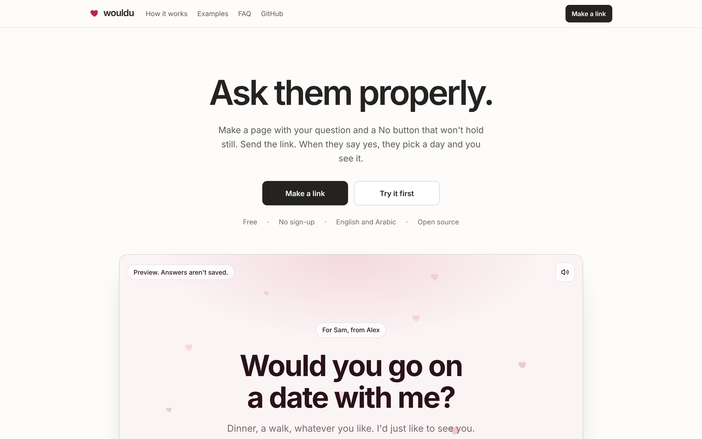
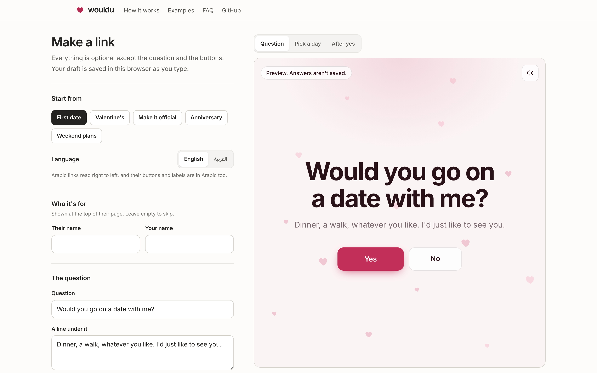
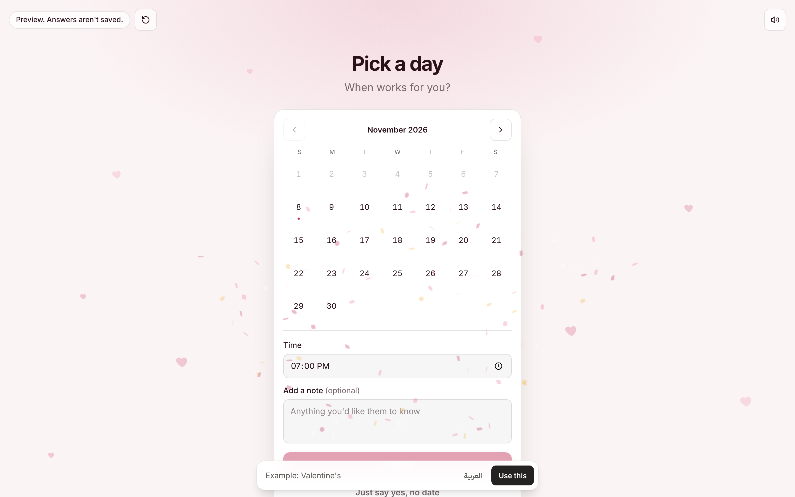
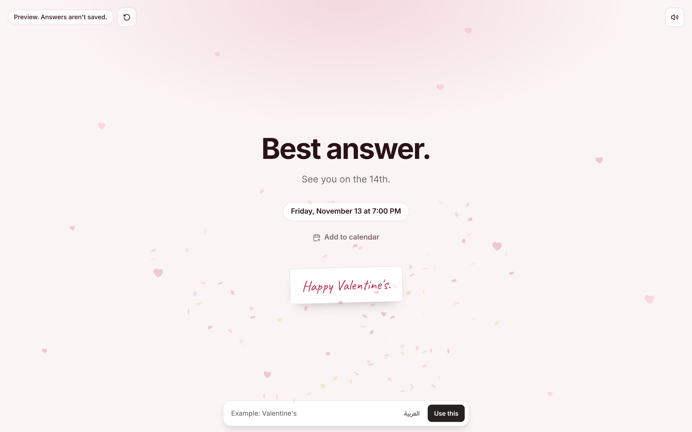
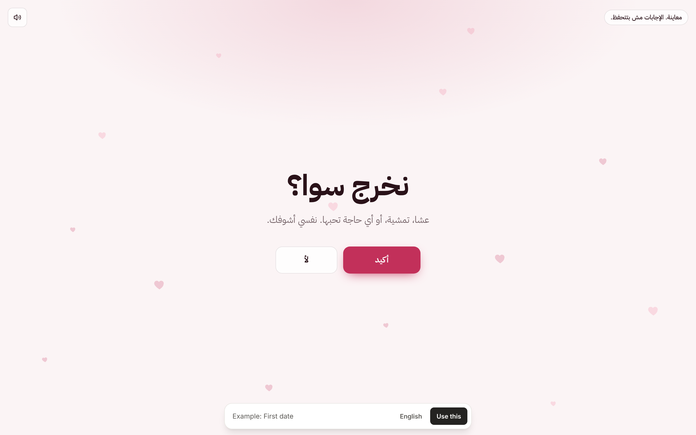

# wouldu

Ask them properly.

Make a page with your question and a No button that won't hold still. Send the link. When they say yes, they pick a day and time, and you see it on a private results page. Free, no sign-up, in English and Arabic.



## What it does

- **The question.** Your words, your buttons, five colour palettes (one dark) and a hearts, sparkles or plain background. Start from one of five examples or from scratch, with a live preview.
- **The No button.** It moves away whenever they reach for it, and says something different each time. It can't record a no.
- **After yes.** They pick a day and time and can leave a note. Both of you can add it to your calendar.
- **Private results.** Each link comes with a results link that only the creator gets. It shows how many times the link was opened, the day they picked, their note, and how many times they tried No. You can delete the link and its answers from there.
- **English and Arabic.** Arabic links read right to left, and every label on the recipient's page is in Arabic too.

No accounts, cookies or tracking scripts.

| | |
|---|---|
|  |  |
|  |  |

## How it works

| Path | What |
|---|---|
| `/` | Landing page with a working demo |
| `/create` | Editor. Also lists the links made in this browser |
| `/ask/<slug>` | The page you send them |
| `/manage/<slug>#key=…` | Private results. The key stays in the URL fragment, so it never reaches a server log |
| `/demo/<template>` | Examples, in preview mode (nothing is saved) |

When you make a link, the browser generates a random owner key and sends it to Convex, which stores only its SHA-256 hash. Results and deletion require the key. The key is kept in your browser's localStorage and shown once as a results link, so keep a copy.

Links made before owner keys existed still open, but have no results page.

## Stack

- [Next.js](https://nextjs.org) 16 (App Router), React 19, Tailwind CSS 4
- [Convex](https://convex.dev) for the database and server functions (`convex/experiences.ts`)
- Vitest and `convex-test` for backend tests

## Run it locally

You need Node.js 20 or newer.

```bash
npm install
npx convex dev        # creates a dev deployment and writes NEXT_PUBLIC_CONVEX_URL to .env.local
npm run dev           # in a second terminal; http://localhost:3000
```

See [`.env.example`](.env.example) for the variables.

## Deploying

The frontend and backend deploy separately. After changing anything in `convex/`, push the functions:

```bash
npx convex deploy
```

## Checks

```bash
npm run typecheck
npm run lint
npm test
npm run build
```
